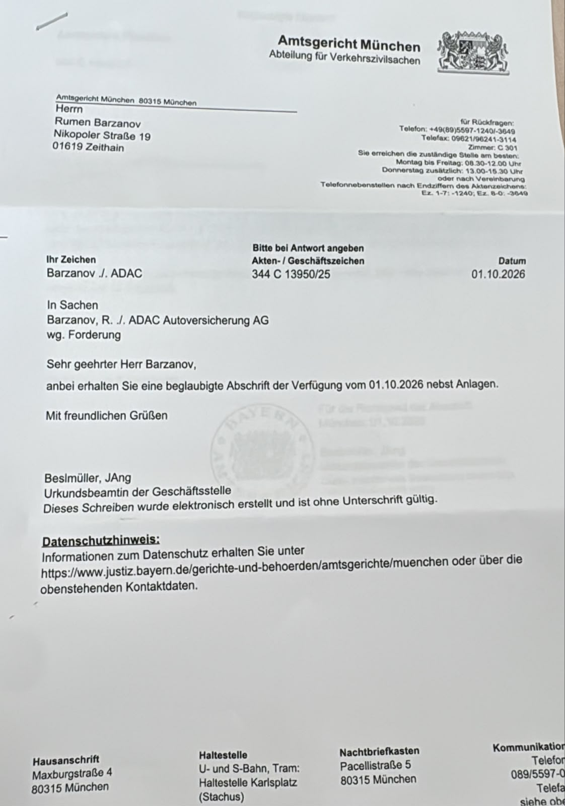

# Amtsgericht München – Anschreiben zur Verfügung vom 01.10.2026

**Abteilung für Verkehrszivilsachen**\
**Aktenzeichen:** 344 C 13950/25\
**Datum:** 01.10.2026

**An:**\
Herrn Rumen Barzanov\
Nikopoler Straße 19\
01619 Zeithain

**Für Rückfragen:** Telefon +49 (89) 5597-1240/-3649; Telefax 09621/96241-3114; Zimmer C 301.\
**Sprechzeiten:** Montag bis Freitag 08:30–12:00 Uhr, Donnerstag zusätzlich 13:00–15:30 Uhr oder nach Vereinbarung.

**Ihr Zeichen:** Barzanov ./. ADAC

**In Sachen:** Barzanov, R. ./. ADAC Autoversicherung AG, wg. Forderung

Sehr geehrter Herr Barzanov,

anbei erhalten Sie eine beglaubigte Abschrift der Verfügung vom 01.10.2026 nebst Anlagen.

Mit freundlichen Grüßen

Beslmüller, JAng\
Urkundsbeamtin der Geschäftsstelle

Dieses Schreiben wurde elektronisch erstellt und ist ohne Unterschrift gültig.

**Datenschutzhinweis:** Informationen zum Datenschutz erhalten Sie unter https://www.justiz.bayern.de/gerichte-und-behoerden/amtsgerichte/muenchen oder über die obenstehenden Kontaktdaten.

**Hausanschrift:** Maxburgstraße 4, 80315 München.\
**Haltestelle:** Karlsplatz (Stachus).\
**Nachtbriefkasten:** Pacellistraße 5, 80315 München.

**Hinweis zur Abschrift:** Der untere rechte Rand mit Teilen der allgemeinen Kontaktangaben ist auf dem Foto abgeschnitten.

---

**Source File:** `2026.10.01_Amtsgericht_Muenchen_Anschreiben.jpg`\

