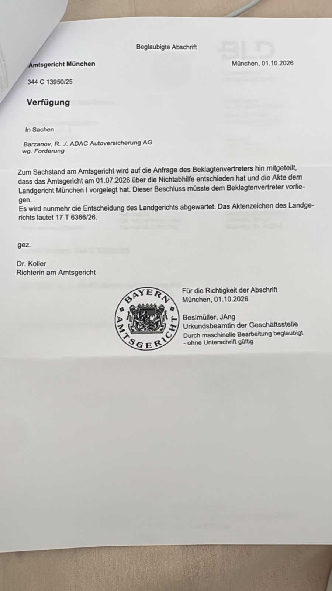

# Amtsgericht München – Verfügung vom 01.10.2026

**Beglaubigte Abschrift**\
**Aktenzeichen:** 344 C 13950/25\
**Ort und Datum:** München, 01.10.2026

**In Sachen:** Barzanov, R. ./. ADAC Autoversicherung AG, wg. Forderung

## Verfügung

Zum Sachstand am Amtsgericht wird auf die Anfrage des Beklagtenvertreters hin mitgeteilt, dass das Amtsgericht am 01.07.2026 über die Nichtabhilfe entschieden hat und die Akte dem Landgericht München I vorgelegt hat. Dieser Beschluss müsste dem Beklagtenvertreter vorliegen.

Es wird nunmehr die Entscheidung des Landgerichts abgewartet. Das Aktenzeichen des Landgerichts lautet **17 T 6366/26**.

gez.\
Dr. Koller\
Richterin am Amtsgericht

**Für die Richtigkeit der Abschrift**\
München, 01.10.2026

Beslmüller, JAng\
Urkundsbeamtin der Geschäftsstelle\
Durch maschinelle Bearbeitung beglaubigt – ohne Unterschrift gültig

---

**Source File:** `2026.10.01_Amtsgericht_Muenchen_Verfuegung.jpg`\

